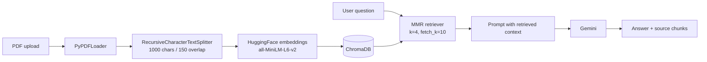

# DocMind

**Chat with your documents.** DocMind is a Retrieval-Augmented Generation (RAG) app that lets you upload PDFs and ask questions about them. Answers are generated only from the retrieved passages of your documents, and the supporting chunks are shown next to every answer so you can verify them.

Built with LangChain, ChromaDB, HuggingFace sentence-transformer embeddings, Google Gemini and Streamlit.

---

## Features

- **Grounded answers.** The LLM is instructed to answer strictly from retrieved context, and to say *"I could not find the answer in the document."* when the context does not contain it.
- **Live PDF ingestion.** Upload a PDF from the UI and it is chunked, embedded and added to the vector store immediately, with no restart needed.
- **Source transparency.** Every answer comes with the retrieved chunks, including the source file name and page.
- **Diverse retrieval.** Uses Maximal Marginal Relevance (MMR) so the retrieved chunks are relevant *and* not redundant.
- **Local vector store.** ChromaDB persists to disk, so your index survives restarts.
- **Clean chat UI.** Streaming-style answers, suggested questions, conversation export to Markdown, and a toggle to show or hide sources.

---

## How it works



1. **Ingest.** A PDF is loaded page by page, split into overlapping chunks, embedded, and stored in Chroma. Each chunk keeps its source file name as metadata.
2. **Retrieve.** The question is embedded and the retriever fetches 10 candidate chunks, then picks the 4 most relevant and diverse ones using MMR.
3. **Generate.** The chunks are inserted into a strict prompt and sent to Gemini at `temperature=0`.
4. **Display.** The UI shows the answer and, optionally, the chunks it was based on.

---

## Tech stack

| Layer | Technology |
| --- | --- |
| UI | Streamlit |
| Orchestration | LangChain |
| Embeddings | `sentence-transformers/all-MiniLM-L6-v2` (HuggingFace) |
| Vector store | ChromaDB (local, persistent) |
| Retrieval | MMR (`k=4`, `fetch_k=10`, `lambda_mult=0.5`) |
| LLM | Google Gemini via `langchain-google-genai` |
| PDF parsing | PyPDF |

---

## Project structure

```
DocMind/
├── app.py               # Streamlit UI
├── rag_core.py          # RAG pipeline: ingestion, retrieval, generation
├── create_database.py   # One-off script to build the initial Chroma index
├── config.toml          # Streamlit configuration
├── requirements.txt     # Python dependencies
├── document loaders/    # Sample documents and loader experiments
├── retrievers/          # Retriever experiments
└── .gitignore
```

`chroma_db/` and `.env` are created locally and are not committed.

---

## Getting started

### Prerequisites

- Python 3.10 or newer
- A Google Gemini API key ([get one here](https://aistudio.google.com/app/apikey))

### 1. Clone the repository

```bash
git clone https://github.com/BhavishyaDaram/DocMind.git
cd DocMind
```

### 2. Create a virtual environment

```bash
python -m venv .venv
source .venv/bin/activate        # macOS / Linux
# .venv\Scripts\activate         # Windows
```

### 3. Install dependencies

```bash
pip install -r requirements.txt
```

`rag_core.py` also imports a few LangChain integration packages. If `requirements.txt` does not list them yet, install them explicitly:

```bash
pip install langchain-huggingface langchain-google-genai langchain-text-splitters
```

### 4. Configure environment variables

Create a `.env` file in the project root:

```env
GEMINI_API_KEY=your_gemini_api_key_here

# Optional: avoids HuggingFace rate limits when downloading the embedding model
HUGGINGFACEHUB_ACCESS_TOKEN=your_hf_token_here
```

### 5. Build the vector database

Put a PDF in the `document loaders/` folder (the script currently reads `document loaders/deeplearning.pdf`), then run:

```bash
python create_database.py
```

This creates the `chroma_db/` folder. The app expects it to exist at startup.

### 6. Run the app

```bash
streamlit run app.py
```

Open the local URL Streamlit prints (usually `http://localhost:8501`).

---

## Usage

1. **Add a document.** Drop a PDF into the upload box and click *Add*. It is indexed and searchable straight away.
2. **Ask a question.** Type in the chat box or click one of the suggested questions.
3. **Check the sources.** Expand *source chunks used* under an answer to see exactly which passages the answer came from.
4. **Export.** Use the sidebar to download the conversation as Markdown, or clear it and start over.

---

## Configuration

Key settings live at the top of `rag_core.py`:

| Setting | Default | Purpose |
| --- | --- | --- |
| `EMBEDDING_MODEL` | `sentence-transformers/all-MiniLM-L6-v2` | Embedding model for chunks and queries |
| `GEMINI_MODEL` | `gemini-3.6-flash` | Gemini model used for generation |
| `chunk_size` / `chunk_overlap` | `1000` / `150` | Chunking of uploaded PDFs |
| `k` / `fetch_k` | `4` / `10` | Chunks returned / candidates considered by MMR |
| `temperature` | `0` | Deterministic, grounded answers |

If you change the embedding model, rebuild `chroma_db/` so stored vectors and query vectors come from the same model.

---

## Troubleshooting

| Symptom | Likely cause and fix |
| --- | --- |
| UI shows *Pipeline offline* | `rag_core.py` failed to import. Read the error shown in the app. Usually a missing package (see step 3) or a missing `.env`. |
| `GEMINI_API_KEY is missing` | Add the key to `.env` in the project root and restart the app. |
| `Chroma database not found` | Run `python create_database.py` first. |
| First run is slow | The embedding model is downloaded the first time. Later runs use the cache. |
| "I could not find the answer in the document" | The answer is not in the indexed documents, or the question needs rewording. Try a more specific question. |

---

## Limitations

- Only PDF uploads are supported in the UI.
- Documents added through the UI are stored in the same Chroma collection, so all questions search across every indexed document.
- There is no per-question conversation memory. Each question is answered independently from retrieved context.

## Roadmap

- [ ] Support DOCX, TXT and web pages
- [ ] Per-document filtering at query time
- [ ] Conversational memory and follow-up questions
- [ ] Reranking for higher retrieval precision
- [ ] Docker setup and one-click deploy

---

## Author

**Bhavishya Daram** · [GitHub](https://github.com/BhavishyaDaram)

## License

Add a license of your choice (for example MIT) in a `LICENSE` file.
